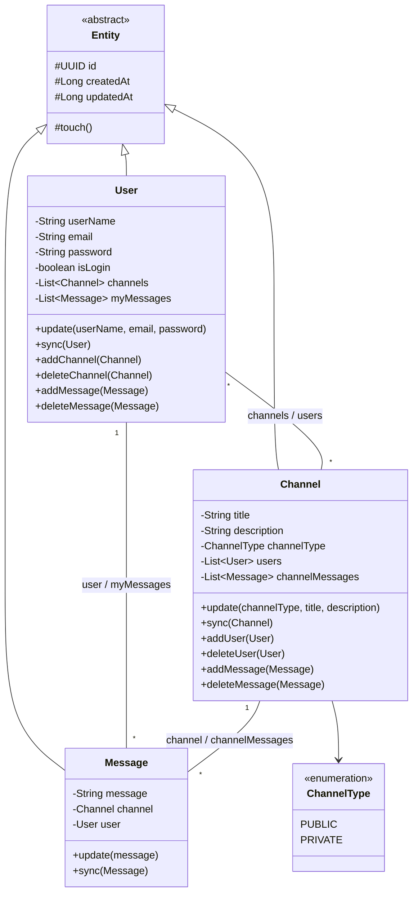
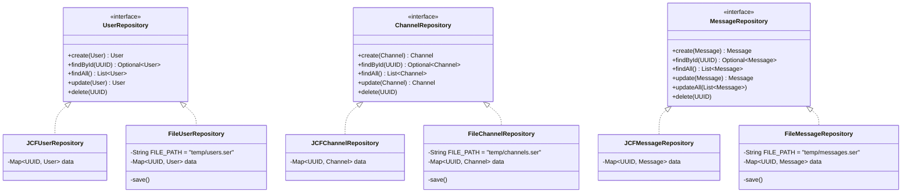
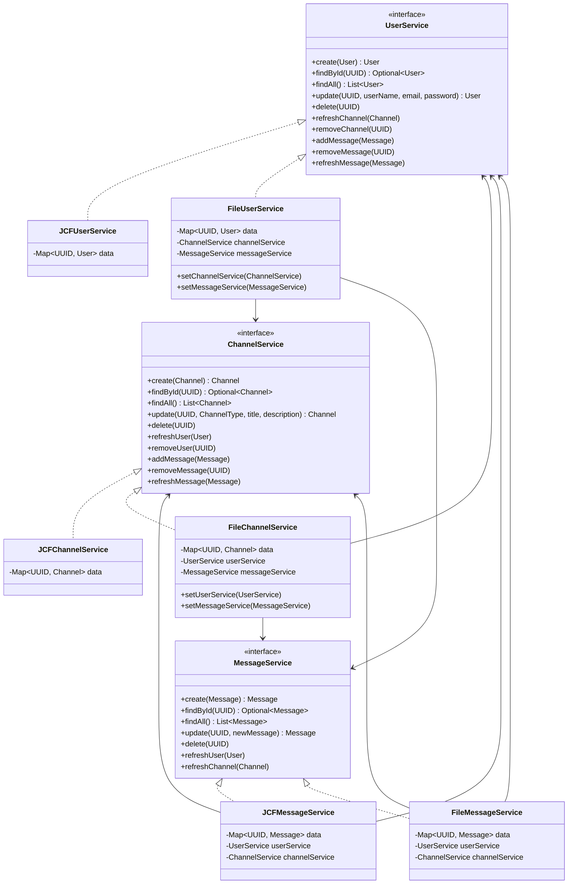
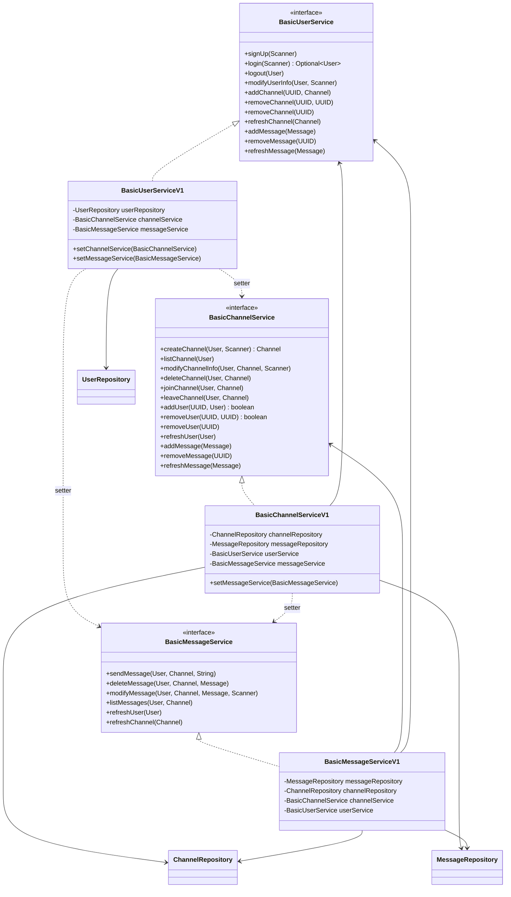

## 진행 현황

### 1차 기본 요구사항

#### 도메인 모델링
- [x] 패키지 `com.sprint.mission.discodeit.entity` 구성
- [x] 공통 필드 정의
  - [x] `id` (UUID)
  - [x] `createdAt`, `updatedAt` (Long, 유닉스 타임스탬프)
- [x] `User`, `Channel`, `Message` 도메인 모델 구현
- [x] 생성자
  - [x] `id`, `createdAt`은 생성자에서 초기화
  - [x] 그 외 필드는 생성자 파라미터로 초기화
- [x] 메소드
  - [x] 각 필드의 `Getter` 정의
  - [x] 필드 수정용 `update` 함수 정의

#### 서비스 설계 및 구현
- [x] 도메인별 CRUD 인터페이스 선언 (`com.sprint.mission.discodeit.service`)
  - [x] 네이밍 규칙 `[도메인 모델 이름]Service` 적용
- [x] JCF 기반 구현체 작성 (`com.sprint.mission.discodeit.service.jcf`)
  - [x] 네이밍 규칙 `JCF[인터페이스 이름]` 적용
  - [x] `data` 필드를 `final`로 선언하고 생성자에서 초기화
  - [x] 생성, 조회(단건/다건), 수정, 삭제 메소드 구현

#### 메인 클래스 (`JavaApplication`)
- [x] 메인 메소드 선언
- [x] 등록 테스트
- [x] 조회(단건, 다건) 테스트
- [x] 수정 테스트
- [x] 수정된 데이터 조회 테스트
- [x] 삭제 테스트
- [x] 삭제 여부 조회 확인

### 심화 요구사항
- [x] 서비스 간 의존성 주입
- [x] 도메인 모델 간 관계 검증 로직 추가 (예: Message 생성 시 연관된 User, Channel 존재 여부 확인)
- [x] 검증 로직 테스트

### 코드 리뷰 반영 사항
  - 리뷰 내용: null 대체 객체를 반환하는 대신, `NullPointerException` 발생 시 `main`까지 던지고 `main`에서 catch하여 처리하는 방식이 더 적절함
  - [x] Null Object 클래스/로직 제거
  - [x] 서비스 계층에서 null 처리 로직 제거 (예외를 그대로 전파)
  - [x] 예외 발생 케이스(존재하지 않는 id 조회 등) 테스트

## 클래스 다이어그램

### Entity

- 모든 Entity는 `Serializable`을 구현합니다.
- `update()`는 null이 아닌 값만 바꾸고 `touch()`로 `updatedAt`을 갱신합니다.
- `sync()`는 파일마다 따로 저장된 같은 id의 복사본에 최신 값을 반영합니다.

### Repository

- `update()`/`delete()`는 저장되지 않은 id면 `NoSuchElementException`을 던집니다.
- File 구현체는 생성 시 `.ser` 파일을 읽고, 변경할 때마다 `save()`로 전체를 다시 씁니다.

### Service (JCF / File)

- `refresh*`/`add*`/`remove*`는 interface의 `default` 메서드로 메모리상의 복사본만 맞추고, `File*Service`는 이를 오버라이드해서 파일 저장까지 처리합니다.

### Service (Basic, Repository 기반)

### 관계 요약

| 관계 | 종류 | 근거 |
|---|---|---|
| `User`, `Channel`, `Message` → `Entity` | 상속 | `extends Entity` |
| `Channel` → `ChannelType` | 단방향 연관 | `channelType` 필드 |
| `User` ↔ `Channel` | 다대다 양방향 | `User.channels`, `Channel.users` |
| `User` ↔ `Message` | 일대다 양방향 | `Message.user`(final), `User.myMessages` |
| `Channel` ↔ `Message` | 일대다 양방향 | `Message.channel`(final), `Channel.channelMessages` |
| `JCF*`/`File*Repository` → `*Repository` | 구현 | `implements` |
| `JCF*`/`File*Service` → `*Service` | 구현 | `implements` |
| `Basic*ServiceV1` → `Basic*Service` | 구현 | `implements` |
| `Basic*ServiceV1` → `*Repository` | 의존 (생성자 주입) | 저장 로직은 Repository에 위임 |
| `*MessageService` → `UserService`, `ChannelService` | 의존 (생성자 주입) | Message 생성 시 User/Channel 존재 여부 검증 |

### Service 순환 의존 처리

User, Channel, Message 서비스는 서로가 보관한 복사본을 맞춰야 해서 순환 의존이 생깁니다.
먼저 생성할 수 있는 쪽은 생성자로, 나중에 연결해야 하는 쪽은 setter로 주입합니다.

- JCF: `JCFUserService`, `JCFChannelService` → `JCFMessageService(userService, channelService)`
- File: `FileUserService`, `FileChannelService` 생성 → `FileMessageService(userService, channelService)` 생성 → `setChannelService`/`setUserService`/`setMessageService`로 연결
- Basic: `BasicUserServiceV1(userRepository)` → `BasicChannelServiceV1(channelRepository, messageRepository, userService)` → `BasicMessageServiceV1(messageRepository, channelRepository, channelService, userService)` → `setChannelService`/`setMessageService`로 연결

# 요구사항

## 2차 기본 요구사항

### File IO를 통한 데이터 영속화

- [x] 다음 조건을 만족하는 서비스 인터페이스의 구현체를 작성하세요.
  - [x] 클래스 패키지명: `com.sprint.mission.discodeit.service.file`
  - [x] 클래스 네이밍 규칙: `File[인터페이스 이름]`
  - [x] JCF 대신 FileIO와 객체 직렬화를 활용해 메소드를 구현하세요.
    - 참고: 객체 직렬화/역직렬화 가이드
- [ ] `Application`에서 서비스 구현체를 `File*Service`로 바꾸어 테스트해보세요.

### 서비스 구현체 분석

- [ ] `JCF*Service` 구현체와 `File*Service` 구현체를 비교하여 공통점과 차이점을 발견해보세요.
  - [ ] "비즈니스 로직"과 관련된 코드를 식별해보세요.
  - [ ] "저장 로직"과 관련된 코드를 식별해보세요.

### 레포지토리 설계 및 구현

- [x] "저장 로직"과 관련된 기능을 도메인 모델 별 인터페이스로 선언하세요.
  - [x] 인터페이스 패키지명: `com.sprint.mission.discodeit.repository`
  - [x] 인터페이스 네이밍 규칙: `[도메인 모델 이름]Repository`
- [x] 다음 조건을 만족하는 레포지토리 인터페이스의 구현체를 작성하세요. (JCF)
  - [x] 클래스 패키지명: `com.sprint.mission.discodeit.repository.jcf`
  - [x] 클래스 네이밍 규칙: `JCF[인터페이스 이름]`
  - [x] 기존에 구현한 `JCF*Service` 구현체의 "저장 로직"과 관련된 코드를 참고하여 구현하세요.
- [x] 다음 조건을 만족하는 레포지토리 인터페이스의 구현체를 작성하세요. (File)
  - [x] 클래스 패키지명: `com.sprint.mission.discodeit.repository.file`
  - [x] 클래스 네이밍 규칙: `File[인터페이스 이름]`
  - [x] 기존에 구현한 `File*Service` 구현체의 "저장 로직"과 관련된 코드를 참고하여 구현하세요.

---

## 심화 요구사항

### 관심사 분리를 통한 레이어 간 의존성 주입

- [x] 다음 조건을 만족하는 서비스 인터페이스의 구현체를 작성하세요.
  - [x] 클래스 패키지명: `com.sprint.mission.discodeit.service.basic`
  - [x] 클래스 네이밍 규칙: `Basic[인터페이스 이름]`
  - [x] 기존에 구현한 서비스 구현체의 "비즈니스 로직"과 관련된 코드를 참고하여 구현하세요.
  - [x] 필요한 Repository 인터페이스를 필드로 선언하고 생성자를 통해 초기화하세요.
  - [x] "저장 로직"은 Repository 인터페이스 필드를 활용하세요. (직접 구현하지 마세요.)
