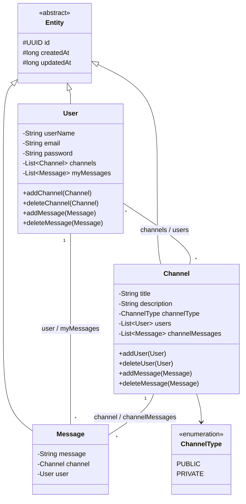
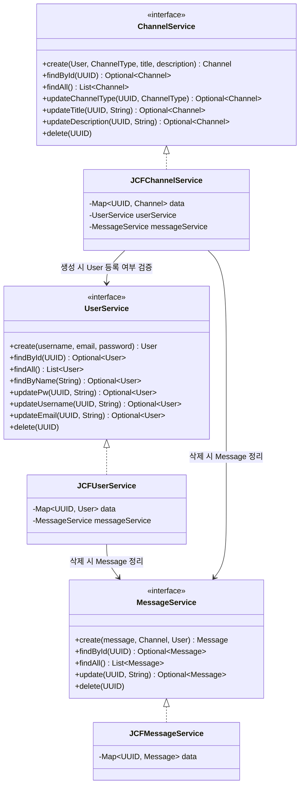

## 진행 현황

### 1차 기본 요구사항

#### 도메인 모델링
- [x] 패키지 `com.sprint.mission.discodeit.entity` 구성
- [x] 공통 필드 정의
  - [x] `id` (UUID)
  - [x] `createdAt`, `updatedAt` (Long, 유닉스 타임스탬프)
- [x] `User`, `Channel`, `Message` 도메인 모델 구현
- [x] 생성자
  - [x] `id`, `createdAt`은 생성자에서 초기화
  - [x] 그 외 필드는 생성자 파라미터로 초기화
- [x] 메소드
  - [x] 각 필드의 `Getter` 정의
  - [x] 필드 수정용 `update` 함수 정의

#### 서비스 설계 및 구현
- [x] 도메인별 CRUD 인터페이스 선언 (`com.sprint.mission.discodeit.service`)
  - [x] 네이밍 규칙 `[도메인 모델 이름]Service` 적용
- [x] JCF 기반 구현체 작성 (`com.sprint.mission.discodeit.service.jcf`)
  - [x] 네이밍 규칙 `JCF[인터페이스 이름]` 적용
  - [x] `data` 필드를 `final`로 선언하고 생성자에서 초기화
  - [x] 생성, 조회(단건/다건), 수정, 삭제 메소드 구현

#### 메인 클래스 (`JavaApplication`)
- [x] 메인 메소드 선언
- [x] 등록 테스트
- [x] 조회(단건, 다건) 테스트
- [x] 수정 테스트
- [x] 수정된 데이터 조회 테스트
- [x] 삭제 테스트
- [x] 삭제 여부 조회 확인

### 심화 요구사항
- [x] 서비스 간 의존성 주입
- [x] 도메인 모델 간 관계 검증 로직 추가 (예: Message 생성 시 연관된 User, Channel 존재 여부 확인)
- [x] 검증 로직 테스트

### 코드 리뷰 반영 사항
  - 리뷰 내용: null 대체 객체를 반환하는 대신, `NullPointerException` 발생 시 `main`까지 던지고 `main`에서 catch하여 처리하는 방식이 더 적절함
  - [x] Null Object 클래스/로직 제거
  - [x] 서비스 계층에서 null 처리 로직 제거 (예외를 그대로 전파)
  - [x] 예외 발생 케이스(존재하지 않는 id 조회 등) 테스트

## 남은 작업
1. 코드 리뷰 반영: Null Object 제거 및 `main`에서 예외 처리
2. `JavaApplication`에 수정 → 수정 후 조회 → 삭제 → 삭제 확인 테스트 추가
3. 심화: Message 생성 시 User, Channel 존재 여부 검증 및 테스트

## 클래스 다이어그램

### Entity

### Service

### 관계 요약

| 관계 | 종류 | 근거 |
|---|---|---|
| `User`, `Channel`, `Message` → `Entity` | 상속 | `extends Entity` |
| `Channel` → `ChannelType` | 단방향 연관 | `channelType` 필드 |
| `User` ↔ `Channel` | 다대다 양방향 | `User.channels`, `Channel.users` |
| `User` ↔ `Message` | 일대다 양방향 | `Message.user`(final), `User.myMessages` |
| `Channel` ↔ `Message` | 일대다 양방향 | `Message.channel`(final), `Channel.channelMessages` |
| `JCF*Service` → `*Service` | 구현 | `implements` |
| `JCFUserService`, `JCFChannelService` → `MessageService` | 의존 (생성자 주입) | 삭제 시 연관 Message를 `messageService.delete()`로 정리 |
| `JCFChannelService` → `UserService` | 의존 (생성자 주입) | Channel 생성 시 `userService.findById()`로 등록된 User인지 검증 |

### Service 의존 방향 규칙

Service 간 의존은 `ChannelService → UserService → MessageService` 한 방향으로만 둡니다.

- `MessageService`는 다른 Service에 의존하지 않습니다.
- `UserService`는 `ChannelService`에 의존하지 않습니다.
- 역방향 의존이 필요해지면(예: Message 생성 시 User/Channel 존재 여부 검증) 순환 참조가 생기므로, Service 간 직접 의존 대신 Repository 계층 분리를 검토합니다.
